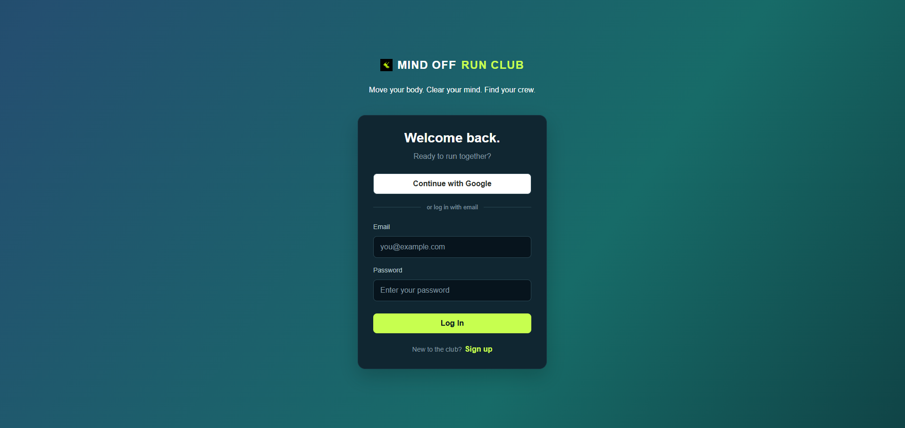

#  Mind Off Run Club 

Mind Off Run Club is a social running community app where users can connect with other runners, share posts and images, and build friendships.

## Features

- **User Authentication** — Sign up and log in using email and password or Google.
- **Community Feed** — Create and view posts shared by the community.
- **Image Posts** — Upload and share images with post content.
- **Post Visibility** — Share posts publicly or with accepted friends.
- **Friend Requests** — Discover users, send friend requests, and accept requests.
- **Your Crew** — View accepted friends in the sidebar.
- **User Profile** — View and edit profile information, including avatar and bio.

## Tech Stack

- React
- Vite
- JavaScript
- CSS
- Node.js
- Express.js
- Supabase Authentication
- Supabase PostgreSQL Database
- Supabase Storage
- Railway
- Vercel
- Git and GitHub

## Deployment

- **Frontend:** Vercel application
- **Backend API:** Railway application
- **Database and Storage:** Supabase PostgreSQL

## API Endpoints

**Base URL:** `https://mind-off-run-club-api-production.up.railway.app`

**Authentication:** Protected endpoints require the Supabase access token in the request header:

`Authorization: Bearer <access_token>`

| Method | Endpoint | Authentication | Description |
|---|---|---|---|
| GET | `/` | No | View API documentation |
| GET | `/health` | No | Check API status |
| POST | `/signup` | No | Register a new account |
| POST | `/login` | No | Log in and obtain an access token |
| GET | `/profile` | Yes | Get the current user's profile |
| PUT | `/profile` | Yes | Update the current user's profile |
| GET | `/users` | Yes | Get other users and their friendship statuses |
| POST | `/friends` | Yes | Send a friend request |
| GET | `/friends` | Yes | Get friend requests and friendships |
| PUT | `/friends/:id` | Yes | Accept an incoming friend request |
| POST | `/posts` | Yes | Create a post with optional image upload |
| GET | `/posts` | Yes | Get posts visible to the current user |
